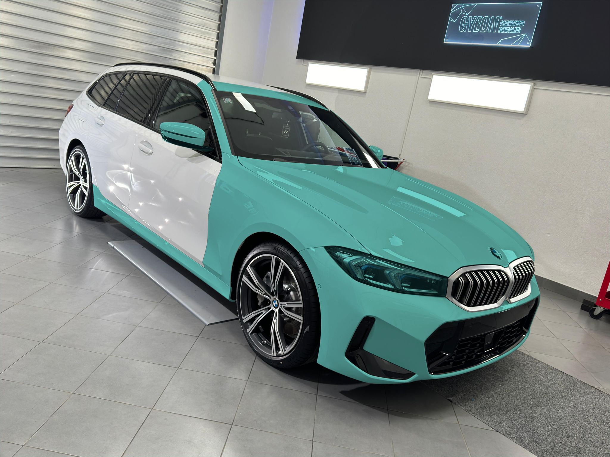

Within days of collecting the car it went to a **Gyeon Certified Detailer** for a full protection
package. The idea was simple: protect the parts that take stone chips with film, then coat
everything for gloss and easy washing.

## Paint protection film

Gyeon PPF went on the areas that face the road. The green areas on the map below show the coverage:

- **Front bumper**, including the edges into the air intakes
- **Bonnet**, full panel
- **Front wings**
- **Headlights**
- **Mirror caps**
- **A-pillars** and the **front edge of the roof**
- **Gloss black door pillar trims**
- Two areas of the **rear bumper**:
  - a strip along the top, below the boot lid, to protect the paint when loading and unloading
  - a small strip low down behind each rear wheel, against dirt and stones thrown up by the tyres
- **Side skirts**, the full length of both sides

The film is cut to wrap around panel edges wherever possible, so the joins are hard to see. The
edges that do show are on the wing-to-door gap and the roof above the windscreen.

## Ceramic coating

After the film was fitted, the car was decontaminated and the paint and trim were ceramic-coated
with Gyeon coating, including the rear bumper. The coating
adds depth to the Alpine White, makes the car much easier to wash, and helps dirt and water slide off.

## Aftercare

- Wait a week after the coating before the first wash
- Hand wash only, using two buckets and a pH-neutral shampoo
- No automatic car washes
- Top up with a Gyeon maintenance spray every few washes
